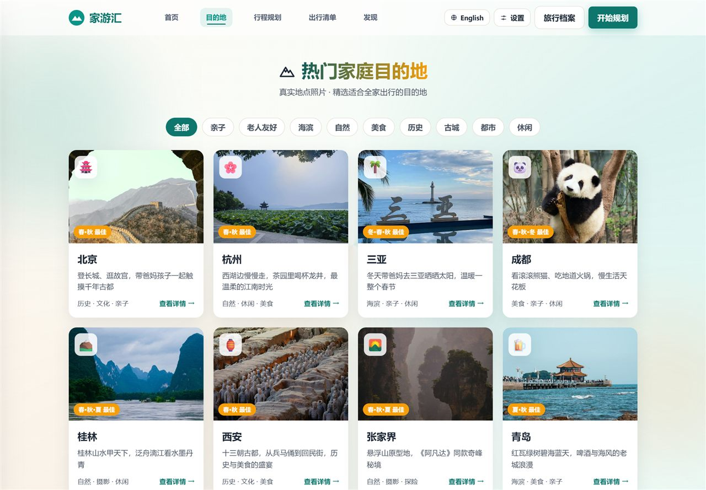
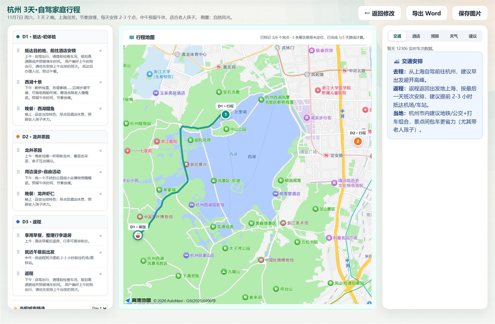
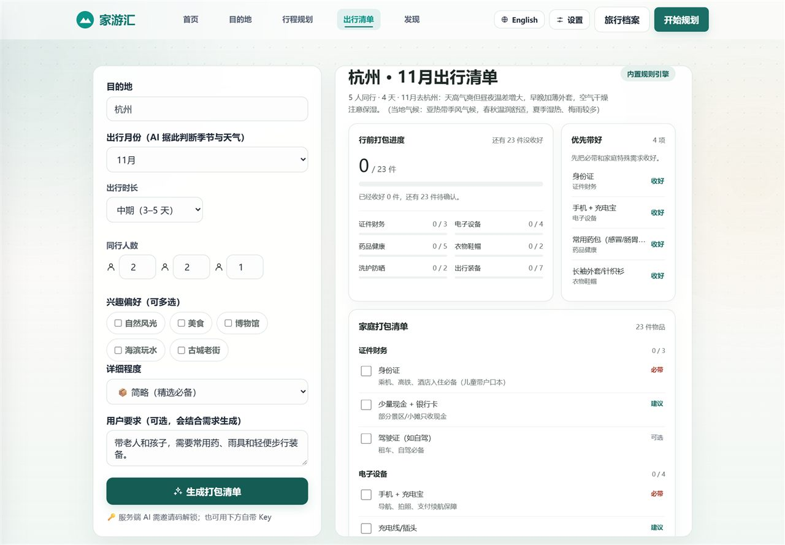
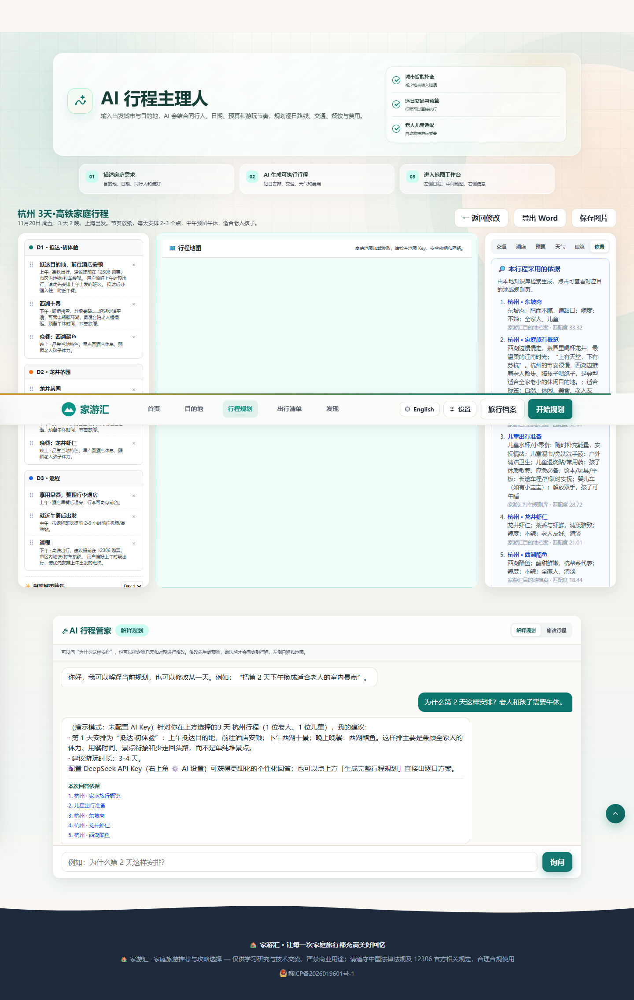
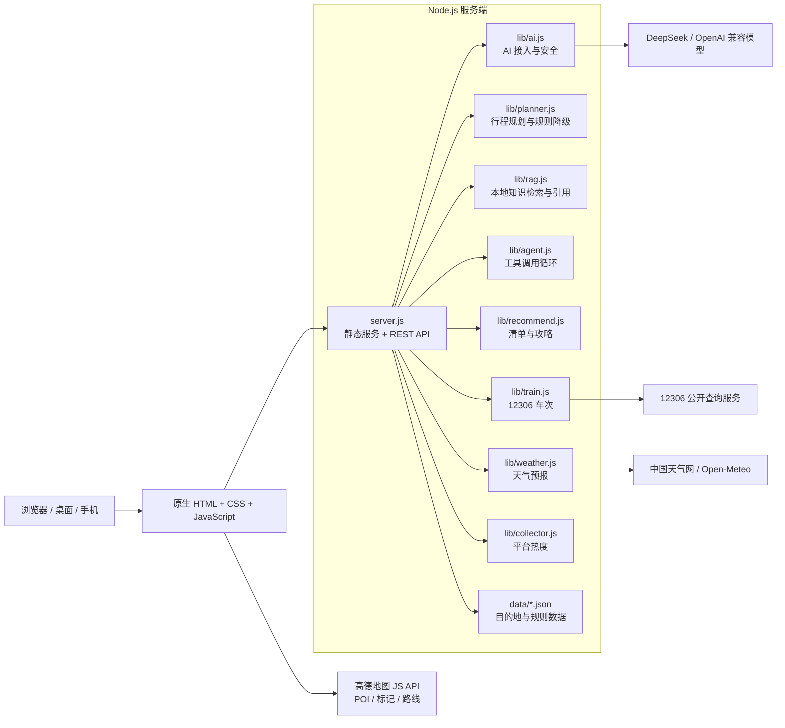

<div align="center">

# 🏡 家游汇 · Family Trip Hub

**面向中国家庭的 AI 旅行规划与攻略平台**

把行程、12306 车次、天气、地图路线和出行清单，放进同一条家庭旅行链路。


[🌐 在线体验](https://familytravelhublz.top) ·
[核心能力](#核心能力) ·
[技术架构](#技术架构) ·
[快速开始](#快速开始) ·
[环境配置](#环境配置)

</div>

> [!IMPORTANT]
> 家游汇不是只给出一段旅行文案的聊天机器人。它会结合家庭成员的实际情况，生成逐日行程，并继续查询天气、火车班次、地图位置和出行清单。
>
> AI 服务不可用时，内置规则引擎会自动接管，核心流程仍然可以完整使用。

## 项目简介

家庭旅行通常要同时考虑老人和孩子的体力、饮食忌口、预算、交通、天气和每天的节奏。信息分散在多个平台时，规划一趟旅行往往比旅行本身更累。

**家游汇**将这些问题收进一个清晰的产品流程：

```text
选择目的地与同行人
        ↓
生成个性化逐日行程
        ↓
查询 12306 车次与所选日期天气
        ↓
在地图上查看每日地点与路线
        ↓
生成与本次行程匹配的出行清单
```

项目使用 **原生 HTML / CSS / JavaScript + Node.js** 实现，不需要前端框架和 npm 运行时依赖，部署简单，也适合低配置服务器运行。

## 核心能力

| 能力 | 说明 |
| --- | --- |
| 🤖 AI 家庭行程规划 | 根据出发地、目的地、日期、老人儿童、预算、节奏、兴趣和特殊要求生成逐日行程 |
| 🔎 本地 RAG 引用 | BM25 双字检索目的地、适老、餐饮与打包知识，行程中展示可点击依据 |
| 🧰 Agent 工具编排 | 模型自主选择本地检索、12306 和天气工具，记录调用轨迹并限制轮次与白名单 |
| 💬 流式 AI 管家 | SSE 阶段状态、逐字输出与安全降级，回答附带本次采用的来源 |
| 📷 攻略截图导入 | 识别截图中的目的地、日期、同行人与忌口，经用户确认后预填规划表单 |
| 🚄 12306 真实车次 | 高铁与火车方案优先使用真实车次、时刻和票价，避免让 AI 编造班次 |
| 🗺️ 高德地图路线 | 按天展示景点、餐饮、车站和自由活动点，支持步行、驾车路线与地点详情 |
| 🌤️ 目的地天气 | 结合所选出行日期展示天气预报，主数据源失败时自动切换备用数据源 |
| 🎒 AI 出行清单 | 支持短期、中期、长期和超详细模式，并可关联最近一次行程规划 |
| 🏞️ 家庭目的地库 | 40+ 国内家庭旅行目的地，包含实景图片、当地美食和适老提示 |
| 🌏 中英双语 | 页面、表单、提示和主要生成内容支持中英文切换 |
| 👵 长辈模式 | 大字体、高对比、大按钮和语音朗读，降低家庭成员的使用门槛 |
| 🛟 多级降级 | AI、天气或地图异常时给出明确提示，文字行程与规则引擎仍可继续工作 |

## 在线体验

**演示地址：** <https://familytravelhublz.top>

推荐体验顺序：

1. 在首页浏览精选家庭目的地。
2. 进入目的地详情，查看亮点、美食、天气和适老提示。
3. 打开「行程规划」，填写家庭出行需求。
4. 生成逐日行程，查看天气与 12306 车次。
5. 点击「生成地图规划」，检查每日地点与路线。
6. 前往「出行清单」，生成与行程关联的打包方案。
7. 切换中英文和长辈模式，检查不同家庭成员的体验。

> 评审老师请直接看 [`docs/评委快速上手.md`](docs/评委快速上手.md)：3 分钟走完主链路，含 AI 体验方式与常见问题。

> 部署到 Ubuntu 前按 [`docs/Ubuntu上线前检查.md`](docs/Ubuntu上线前检查.md) 完成真实 Key、SSE 代理、地图域名和回滚检查。

## 功能截图

| 首页 | 目的地库 |
| --- | --- |
|  |  |

| 家庭约束输入 | 行程地图工作台 |
| --- | --- |
|  |  |

| 出行清单 | 发现下一站 |
| --- | --- |
|  |  |



<p align="center">
  
</p>


## 技术架构



### 技术栈

| 层级 | 技术方案 |
| --- | --- |
| 前端 | 原生 HTML、CSS、JavaScript，响应式布局，无构建步骤 |
| 服务端 | Node.js 18+，CommonJS，原生 `http` 服务 |
| AI | OpenAI 兼容 `/chat/completions`，默认 DeepSeek |
| 地图 | 高德地图 Web 端 JS API |
| 数据 | 本地 JSON 数据与规则库 |
| 部署 | PM2 + Nginx + HTTPS |

## 一次 AI 行程如何生成

1. 浏览器提交目的地、日期、家庭偏好和交通要求。
2. 服务端从本地知识库检索适老、餐饮、景点与打包依据，并保留来源。
3. 模型在检索、12306 和天气三个白名单工具之间自主选择并调用。
4. 工具结果回填后，通过 OpenAI 兼容接口生成结构化逐日行程。
5. 对 AI 结果进行 JSON 清洗、景点去重，并附上引用与工具轨迹。
6. 后台任务返回结果，前端展示逐日行程、可点击依据和 Agent 调用记录。
7. AI 超时或失败时，由内置规则引擎生成可执行方案；核心事实仍来自工具和本地数据。

## 快速开始

### 环境要求

- Node.js 18 或更高版本
- 现代浏览器：Chrome、Edge、Safari 或 Firefox
- AI 与地图能力为可选配置；不配置时仍可使用规则引擎和文字行程

### 本地运行

```bash
git clone https://github.com/ZIPzP/jiayouhui.git
cd jiayouhui
node server.js
```

浏览器打开：

```text
http://localhost:3000
```

项目不需要执行 `npm install`。

Windows 可以直接双击根目录的 `启动.bat`（macOS / Linux 用 `bash 启动.sh`）：它会检查 Node 版本、端口占用，缺少配置时自动复制模板，然后打开浏览器。

## 环境配置

复制配置模板：

```bash
cp config.local.example.json config.local.json
```

Windows PowerShell：

```powershell
Copy-Item config.local.example.json config.local.json
```

`config.local.json` 已被 `.gitignore` 排除，**不要提交到仓库**。

### 环境变量

| 变量 | 用途 |
| --- | --- |
| `AI_API_KEY` | AI 服务端 API Key |
| `AI_BASE_URL` | OpenAI 兼容接口地址 |
| `AI_MODEL` | 模型名称 |
| `AI_VISION_MODEL` | 截图识别模型，默认 `deepseek-flash` |
| `AI_MAX_TOKENS` | 单次模型输出上限，默认 8000 |
| `AI_TIMEOUT_MS` | AI 请求超时时间（默认 120000） |
| `AI_ALLOW_PRIVATE_BASE_URL` | 设为 `1` 时才允许浏览器填写内网 AI 地址，仅私有化部署使用，默认关闭 |
| `AI_MAX_CONCURRENT` | 同时打到上游模型的最大请求数（默认 3），超出排队，防止小服务器被一起拖慢 |
| `AI_MAX_QUEUE` | 上游排队上限（默认 40），超过直接提示稍后再试 |
| `AMAP_JS_KEY` | 高德地图 Web 端 JS API Key |
| `AMAP_SECURITY_CODE` | 高德地图安全密钥 |
| `TAVILY_API_KEY` | Tavily 全网搜索 Key，用于「发现」页补充文旅文章（可选） |
| `PORT` | 服务端口，默认 `3000` |
| `HOST` | 监听地址，默认 `0.0.0.0` |

以上变量都可以不配置：不配 AI Key 时走内置规则引擎，不配地图 Key 时保留文字行程与清单。

## AI 配置

默认配置：

```text
Base URL: https://api.deepseek.com/v1
Model:    deepseek-flash
```

也支持其他 OpenAI 兼容服务。推荐将服务端 Key 写入本地配置，而不是提交到代码中：

```bash
node tools/set-key.js 你的APIKey
```

清除服务端 Key：

```bash
node tools/set-key.js --clear
```

页面「⚙️ 设置 → AI 设置」也支持填写个人 Key，仅保存在当前浏览器。

### 服务端邀请码

如果需要限制匿名用户消耗服务端 AI 额度，可以启用邀请码：

```bash
node tools/set-invite.js 你的邀请码
```

邀请码只用于换取签名设备令牌，**服务端 API Key 不会下发到浏览器**。

## 高德地图配置

在[高德开放平台](https://lbs.amap.com/)创建 Web 端 JS API Key 和安全密钥，然后执行：

```bash
node tools/set-map.js 你的高德JSKey 你的安全密钥
```

清除地图配置：

```bash
node tools/set-map.js --clear
```

建议在高德控制台将 Key 限制到实际使用的域名。

## 安全与可靠性

- API Key 优先从服务端环境变量或 `config.local.json` 读取。
- 服务端已有 Key 时，不使用浏览器传入的 Key。
- 浏览器自定义模型地址只允许 HTTPS 公网域名，降低 SSRF 风险。
- AI 接口按 IP 限流，并设置请求超时。
- 邀请码换取可失效的签名令牌。
- 服务端提供 CSP、安全响应头和静态文件路径保护。
- AI、天气和地图均设计失败提示或降级路径。
- `config.local.json`、日志和本地调试文件不应进入 Git。

## 项目结构

```text
jiayouhui/
├── server.js                  # HTTP 服务、静态资源与 REST API
├── config.json                # 默认配置
├── config.local.example.json  # 本地配置模板
├── ecosystem.config.js        # PM2 进程配置
├── data/
│   ├── destinations.json      # 目的地数据
│   ├── cities.json            # 城市名单
│   ├── packing-db.json        # 打包清单规则
│   ├── weather-codes.json     # 天气城市代码
│   └── trending.json          # 平台热度数据
├── lib/
│   ├── ai.js                  # OpenAI 兼容客户端
│   ├── planner.js             # 行程规划与规则引擎
│   ├── rag.js                 # 本地知识分块、BM25 检索与引用
│   ├── agent.js               # 白名单工具调用循环
│   ├── recommend.js           # 清单与攻略
│   ├── train.js               # 12306 车次查询
│   ├── weather.js             # 天气查询
│   └── collector.js           # 热度聚合
├── public/
│   ├── *.html                 # 正式页面
│   ├── css/style.css          # 全站样式
│   ├── js/                    # 页面脚本与地图逻辑
│   └── images/                # 目的地实景图片
├── docs/
│   ├── 评委快速上手.md         # 3 分钟主链路、AI 体验方式、常见问题
│   └── screenshots/           # README 与文档配图（截图 / 架构图）
├── test/                      # node:test 单元测试与接口冒烟测试
├── scripts/check-syntax.js    # 全仓 JS 语法自检（npm run check）
├── tools/                     # 配置与数据维护脚本
├── deploy/                    # 部署配置（Nginx / 服务器初始化 / 测试环境说明）
├── 启动.bat / 启动.sh          # 本地一键启动（Windows / macOS·Linux）
└── logs/                      # pm2 运行日志（不入 git）
```

## API 一览

| 方法 | 路径 | 说明 |
| --- | --- | --- |
| `GET` | `/api/destinations` | 目的地列表 |
| `GET` | `/api/destinations/:id` | 目的地详情 |
| `GET` | `/api/images` | 实景图片列表 |
| `GET` | `/api/cities` | 城市名称与拼音 |
| `GET` | `/api/weather?id=` | 目的地天气预报 |
| `GET` | `/api/hot-data` | 平台热度数据 |
| `GET` | `/api/job?id=` | 查询后台任务 |
| `POST` | `/api/plan` | 生成家庭行程 |
| `POST` | `/api/recommend` | 生成出行清单 |
| `POST` | `/api/ai-guide` | 生成目的地攻略 |
| `POST` | `/api/chat` | AI 主理人问答 |
| `POST` | `/api/chat/stream` | SSE 流式问答、阶段状态与引用 |
| `POST` | `/api/vision` | 攻略截图结构化预填 |
| `GET` | `/api/rag/search` | 本地知识检索与引用调试 |
| `GET` | `/api/map/config` | 地图前端配置 |
| `GET` | `/api/health` | 健康检查 |

## 测试

项目零依赖，测试直接用 Node 自带的 test runner，不需要安装任何框架：

```bash
npm test        # 单元测试 + AI 客户端 + Agent 闭环 + 接口冒烟
npm run check   # 全部 JS 文件语法检查（含 public/js）
```

覆盖内容：

| 层次 | 覆盖点 |
| --- | --- |
| 安全函数 | 内网地址判定（含 `::ffff:127.0.0.1`、解析到内网的域名）、AI 返回 JSON 清洗 |
| 规则引擎 | 天数钳制 1–14 天、中英文输出结构、自定义目的地骨架 |
| 数据完整性 | 目的地字段与坐标、城市库规模、图片路径都指向真实文件 |
| 接口冒烟 | 真实启动服务后检查健康接口、只读接口、404 与路径穿越、参数校验、后台任务全流程；并回归「畸形路径不能打挂进程」 |
| RAG / Agent | 中文双字检索、来源字段、工具循环、白名单拒绝、工具结果回填和真实后台任务闭环 |
| AI 交互 | DeepSeek 当前模型参数、工具调用解析、SSE 思考与逐字内容解析、无 Key 流式降级 |
| 多模态安全 | 图片格式与大小校验、无 Key 错误边界、截图结果只预填不自动提交 |

CI（`.github/workflows/deploy.yml`）会先跑语法检查 + 测试 + 冒烟，全部通过才部署到服务器；部署后健康检查失败会自动回滚到上一个提交。

## 部署

推荐生产环境：

```text
用户浏览器
    ↓ HTTPS
Nginx
    ↓
PM2 托管的 Node.js 服务
    ↓
data / lib / 外部数据服务
```

部署后可检查：

```bash
curl -s https://familytravelhublz.top/api/health
```

项目还提供阿里云部署脚本、Nginx 配置与运维文档。

## 团队

**团队名称：** 糯叽叽队

| 成员 | 负责内容 |
| --- | --- |
| 朱祺鹏 | 全栈与 AI 接入 |
| 严晟辰 | 前端与视觉 |
| 宋雅丽 | 测试与文档 |

学校：江西软件职业技术大学

## 后续计划

- 扩充更多适合家庭出行的国内目的地。
- 改进景点顺序与每日路线的时间、距离约束。
- 增强中英文生成内容的一致性。
- 使用真实 DeepSeek Key 完成线上视觉识别与工具选择复测。
- 增加更多合规的交通、天气和城市数据源。
- 完善无障碍与长辈模式。
- 增加自动化回归测试和部署检查。

## 免责声明

本项目用于学习、研究与技术交流。AI 生成内容、天气、地图、车次和票价仅供参考，请以 12306、航司、气象部门和地图服务商的官方信息为准。

请遵守第三方平台服务条款、图片版权和相关法律法规。

## License

[MIT](LICENSE)
